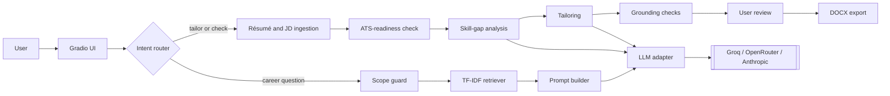

# Purpose and Relationship to the Approved Proposal

This document describes the design of CareerPath Guide, the Group 7 project for MSAI-631-A01. It builds on the group's project proposal dated September 18, 2026 (Group 7, 2026) and extends it with a feature the team has since discussed: helping a user tailor a résumé to a specific job description, check how well the résumé is likely to parse in applicant tracking systems (ATS), and see which skills the résumé lacks relative to the job. The document is a draft for team review. The final section lists the decisions the team must confirm before implementation begins.

The extended design keeps the proposal's core intact: a focused, browser-based chatbot built with Python and Gradio, TF-IDF retrieval over a small curated Markdown knowledge base, a language model reached through a separate provider adapter, a clear fallback for out-of-scope requests, and a modest evaluation. The new capability is added as a second mode of the same application rather than as a replacement.

## What Stays the Same, What Is Added, and What Is Not Used

| Topic | Approved proposal | This design | Status |
|---|---|---|---|
| Interface | Gradio chat in the browser | Gradio chat plus a file upload and a review panel | Extended |
| Career Q&A | TF-IDF over curated Markdown, LLM answer with source-topic label | Unchanged (Mode A) | Same |
| Résumé handling | "Will not store personal résumés or profiles" | Résumé is processed in memory for the current session only and is never written to disk or a database | Needs group and instructor confirmation |
| Job source | "Will not scrape job listings" | The user pastes the job description. No scraping, and JobSpy is not used (see "Why JobSpy Is Not Used") | Same boundary kept |
| Applications | "Will not submit job applications" | Unchanged. The tool produces a downloadable résumé; it never applies on the user's behalf | Same |
| LLM provider | Groq API behind an adapter module | Adapter supports Groq, OpenRouter, and Anthropic; the provider and model are configuration | Extended |
| Retrieval | TF-IDF, no vector database | Unchanged; TF-IDF is also reused for job-to-résumé similarity | Same |
| Out of scope advice | No legal, medical, financial, or mental-health advice; no employment guarantees | Unchanged. The ATS-readiness score is explicitly a heuristic, not a guarantee | Same |

The team should note that two items change the wording of the approved proposal: processing an uploaded résumé (even in memory) and adding two LLM providers. Both are small in engineering terms but should be confirmed with the instructor before they are presented as final scope.

# Product Overview

## Problem and Users

Career advice is plentiful but scattered, and generic advice does not tell a specific applicant what to change for a specific job. Students and early-career professionals commonly send one résumé to many roles. They also cannot easily tell whether the résumé parses cleanly in an ATS or which required skills it fails to show. CareerPath Guide gives a single conversational starting point for both kinds of need.

## Two Modes in One Application

**Mode A: Career Q&A (from the proposal).** The user asks about résumé improvement, behavioral interviews, job-search planning, networking, skill development, or career transitions. The system retrieves the best-matching passage from the curated knowledge base and returns a concise, source-labeled answer.

**Mode B: Résumé Studio (new).** The user supplies a résumé once per session and pastes a job description. The system returns three things: an ATS-readiness report, a skill-gap report, and an optional tailored résumé that the user reviews and accepts before download.

## Example User Journey

1. The user types, "I'm looking for software engineer jobs in Plano." The system treats this as job-search planning, answers from the knowledge base (where to search, which keywords and filters to use, how to read postings), and offers: "Paste a job description and upload your résumé if you want help tailoring it."
2. The user finds a posting on a job site, pastes the description into the chat, and uploads a résumé (PDF or DOCX) once.
3. The system extracts the text, runs the ATS-readiness checks, and compares job requirements to résumé evidence. It shows a score with specific findings and a gap report that separates matched, transferable, and missing skills.
4. The user asks for a tailored résumé. The system rewrites only what the résumé already supports, shows each change next to the original, and lets the user accept or reject each one.
5. The user downloads a single-column DOCX. When the session ends, the résumé text is discarded.

## Scope

In scope: the six proposal topics; session-only résumé upload (PDF, DOCX, plain text); user-pasted job descriptions; ATS-readiness check; skill-gap analysis; grounded résumé tailoring with user review; DOCX export.

Out of scope: legal, medical, financial, or mental-health advice; employment guarantees; storing résumés or user profiles; scraping or searching job boards; auto-applying; vector databases; accounts and logins; hosted deployment beyond an optional demonstration after the local version works.

# Requirements

## Functional Requirements

| ID | Requirement |
|---|---|
| FR-1 | Provide a browser chat interface where the user asks career questions in free text and sees suggested questions. |
| FR-2 | Answer career questions from the curated knowledge base using TF-IDF retrieval, and label each answer with its source topic. |
| FR-3 | Return a clear fallback for out-of-scope requests and for excluded advice categories, without calling the model when possible. |
| FR-4 | Accept one résumé upload (PDF, DOCX, or TXT) per session and keep it in session memory only. |
| FR-5 | Accept a pasted job description and extract required skills, preferred skills, responsibilities, and title. |
| FR-6 | Produce an ATS-readiness report with a score and a list of specific, actionable findings. |
| FR-7 | Produce a skill-gap report that classifies each job skill as matched, transferable (with the résumé quotation that supports it), or missing. |
| FR-8 | For missing skills, suggest learning actions or projects drawn from the knowledge base, and never suggest claiming the skill. |
| FR-9 | Generate a tailored résumé that changes wording, order, and emphasis only where the original résumé supplies evidence. |
| FR-10 | Show every proposed change next to the original and let the user accept or reject it before export. |
| FR-11 | Export the accepted result as a single-column, ATS-friendly DOCX. |
| FR-12 | Let the user change the model provider and model through configuration without code changes. |
| FR-13 | Handle provider errors, rate limits, unreadable files, and image-only PDFs with clear user-facing messages. |
| FR-14 | Let the user clear the session (résumé, job description, and results) with one action. |

## Non-Functional Requirements

| ID | Requirement |
|---|---|
| NFR-1 | Runs locally on a typical laptop in a Python virtual environment. |
| NFR-2 | No résumé or personal data is written to disk, logged, or committed. Logs contain no résumé text. |
| NFR-3 | API keys come from environment variables and are never committed. |
| NFR-4 | Provider-specific code lives only in the adapter package. |
| NFR-5 | The knowledge base is plain Markdown that every member can review. |
| NFR-6 | Deterministic logic (retrieval, parsing, ATS checks, grounding checks) is covered by pytest tests that need no network. |
| NFR-7 | Response time and provider rate-limit behavior are recorded for the evaluation. |
| NFR-8 | The interface states that résumé text is sent to the selected model provider and obtains the user's acknowledgment before the first upload. |

# Research Findings

The team researched five questions that shape the design. Sources are listed in the References section.

## How ATS Software Treats a Résumé

Industry guides consistently describe an ATS as a pipeline: it extracts raw text from the file, detects sections by matching headings against a dictionary of standard names, maps content to fields such as employer, title, dates, and skills, and then lets recruiters search and filter or compares the text to the job description (22skills, n.d.; MirrorCV, n.d.; TailorCV, n.d.). Failures usually occur at the parsing step. Multi-column layouts, tables, text boxes, headers and footers, and image-only files are the most commonly cited causes of scrambled or missing fields. Creative section titles can cause a section to be missed. Matching is largely literal, so a job description that says "TypeScript" is not satisfied by "JavaScript," and multi-word phrases score better when they appear intact (Tailored, n.d.).

Two implications follow. First, an "ATS check" can be implemented as a set of transparent rules about parseability and keyword coverage. Second, the guides disagree with the popular belief in a secret universal ATS score: most systems parse into a searchable database rather than assign a hidden pass/fail number (MirrorCV, n.d.). The feature will therefore be named an ATS-readiness check, will explain every deduction, and will not claim to predict any particular vendor's decision. These are vendor and practitioner sources rather than peer-reviewed studies, which the final report should state as a limitation.

## Risks of LLM-Generated Résumé Rewrites

Two 2026 preprints evaluate fabrication in LLM résumé pipelines. In a controlled experiment with 180 runs, a fully automated baseline produced at least one unsupported claim in 96.7% of outputs. Prompt guardrails cut the number of findings by 86%, yet half the outputs still contained a fabrication. A human checkpoint after the rewriting stage eliminated invented identities, and career changers were the most exposed group (Takano, 2026). A second study proposes layered defenses: temporal validation, deterministic contamination detection, structural checks, prompt-level grounding, and a separate evaluator model. It reports that deterministic checks work independently of the model and that prompt grounding alone is insufficient at higher temperatures or on weaker models (Indukuri & Agrawal, 2026).

The design response is defense in depth: strict prompt rules, deterministic post-checks that compare the output to the source résumé, and a mandatory user review step. The model is never trusted to police itself alone.

## Résumé Tailoring and Skill-Gap Methods

ResumeFlow shows a practical pipeline with no fine-tuning: extract details from the job description, extract role-relevant details from the résumé, and generate a refined résumé. It also proposes two evaluation ideas the team can reuse: job alignment (overlap with the job description) and content preservation (overlap with the original résumé) as a hallucination signal (Zinjad et al., 2024). An open-source example separates gaps into critical and minor, and classifies each as transferable (the résumé shows adjacent evidence, which is quoted) or genuine (no evidence, so it suggests how to build the skill) (Hariprasad, n.d.). This distinction is adopted directly in the design.

## Provider Options

OpenRouter exposes an OpenAI-compatible endpoint at `https://openrouter.ai/api/v1/chat/completions`, authenticated with a Bearer key, and supports a `response_format` parameter for JSON output on models and endpoints that advertise it (OpenRouter, n.d.-a, n.d.-b). It also offers a free-models router, which is convenient for development but non-deterministic in which model answers. Anthropic's Messages API requires a `model` and `max_tokens`, takes the system prompt as a top-level `system` field rather than a message role, and is available through an official Python SDK (Anthropic, n.d.-a, n.d.-b). The proposal's Groq API also offers chat completions with published rate limits (Groq, n.d.-a, n.d.-b). Because model names and capabilities change quickly, the design treats the provider and the model name as configuration and requires the team to confirm current names in each provider's console at implementation time.

## Why JobSpy Is Not Used

JobSpy is an open-source Python library whose `scrape_jobs()` function collects postings from LinkedIn, Indeed, Glassdoor, ZipRecruiter, Google, and other boards into a pandas DataFrame (JobSpy, n.d.). It is technically capable of the "search jobs in Plano" use case, but the team recommends against including it for four reasons.

1. **It contradicts the approved proposal,** which excludes scraping job listings. Using it would be a scope change rather than an extension.
2. **Terms of service.** Indeed's terms prohibit automation, scripting, and bots outside its official tooling (Indeed, 2026). LinkedIn's user agreement prohibits scraping, and in *hiQ Labs v. LinkedIn* the court record shows LinkedIn running dedicated anti-scraping defenses (hiQ Labs, Inc. v. LinkedIn Corp., 2022). The case law on public data is nuanced, but contract and account-blocking risk remains. This is not legal advice, and the team should not rely on it as such.
3. **Reliability.** The library's own documentation states that LinkedIn typically rate-limits after about ten pages from one IP address and that proxies are practically required, while all boards are capped at roughly 1,000 results per search (JobSpy, n.d.). A class demonstration that depends on proxies is fragile.
4. **Unnecessary for the learning goal.** Pasting a job description gives the same input to the tailoring pipeline with no legal or reliability risk. Job-search tactics remain available through the knowledge base.

If the team still wants job search later, the safer path is an official or licensed job-data API behind a feature flag that is off by default, and only with instructor approval.

# System Architecture

## Architecture Overview

The application is a single Python process. Gradio renders the interface, and a small orchestration layer routes each message to Mode A or Mode B. All user data lives in an in-memory session object. The only external call is to the configured model provider.



## Component Summary

| Component | Responsibility | Uses LLM |
|---|---|---|
| Intent router | Decide whether a message is a career question, a tailoring request, or out of scope; detect an attached résumé or pasted job description. | No (rule-based first) |
| Scope guard | Block excluded advice categories and obvious out-of-scope requests with a polite redirect. | No |
| Knowledge-base retriever | TF-IDF index over Markdown passages; returns top passage, topic, and score. | No |
| Résumé ingestion | Extract text and layout signals from PDF, DOCX, or TXT; split into sections; separate contact details. | No |
| Job-description analyzer | Extract title, required skills, preferred skills, and responsibilities as structured JSON. | Yes |
| ATS-readiness checker | Apply deterministic parseability, structure, and keyword rules; produce a score and findings. | No |
| Skill-gap analyzer | Match job skills to résumé evidence; classify as matched, transferable, or missing. | Partly |
| Tailoring engine | Rewrite bullets and summary under grounding rules. | Yes |
| Grounding checker | Compare output to source résumé; flag any unsupported addition. | No |
| LLM adapter | One interface; provider implementations for Groq, OpenRouter, and Anthropic; retries and typed errors. | Wraps calls |
| DOCX exporter | Build a single-column, standard-heading DOCX from accepted content. | No |
| Session store | Hold résumé, job description, and results in memory; clear on demand. | No |

## Technology Stack

| Concern | Choice | Notes |
|---|---|---|
| Language | Python 3.10 or later | Local virtual environment |
| Interface | Gradio Blocks | Chat, `gr.File` for upload, `gr.State` for session data (Gradio, n.d.) |
| Retrieval and similarity | scikit-learn TF-IDF and cosine similarity | In memory; no vector database |
| PDF text and layout | pypdf for text; pdfplumber for word positions | Used to detect multi-column layouts |
| DOCX read and write | python-docx | Also inspects tables, headers, footers, and text boxes |
| LLM access | OpenAI-compatible client for Groq and OpenRouter; Anthropic SDK | Behind the adapter |
| Configuration | Environment variables and a git-ignored `.env` | `LLM_PROVIDER`, `LLM_MODEL`, and one key per provider |
| Testing | pytest | Adapter mocked; fixtures are synthetic |

## Design Principles

Separation of concerns keeps the interface, retrieval, analysis, and provider code in independent modules so members can work in parallel. Deterministic logic comes first: anything that can be checked with rules, such as parseability, keyword coverage, and unsupported additions, is checked with rules, and the model handles only language tasks. Every failure path produces a clear message. Nothing about the user persists. The user stays in control of every change to their résumé.

# Detailed Design

## Intent Routing

The router applies rules in order. A message containing a blocked-category pattern goes to the scope guard. A message that arrives with an uploaded file or a long pasted block that looks like a job description (many lines, terms such as "responsibilities" or "qualifications") goes to Mode B. A message containing tailoring phrases such as "tailor," "customize my résumé," "ATS," or "skill gap" starts Mode B and asks for any missing input. Everything else goes to the retriever, and a low retrieval score returns the out-of-scope fallback. A model-based classifier is an optional later refinement if rule-based routing proves too brittle in testing.

## Knowledge Base and Retrieval

The knowledge base is a folder of Markdown files, one per topic, split into passages at second-level headings. Each file begins with front matter naming the topic key and label. At start-up the system builds a TF-IDF matrix over the passages. A query returns the top passage, its topic label, and its cosine score. A score below a tunable threshold triggers the fallback. In addition to the six proposal topics, the knowledge base gains two small resources used by Mode B: an ATS formatting guide (the rules the checker applies, written in plain language) and a skills taxonomy file that lists common skills with aliases and learning suggestions, which supports both normalization and gap recommendations.

## Résumé Ingestion

The ingestion module converts an uploaded file into a `ResumeProfile`. For PDF it extracts text with pypdf and, if available, word coordinates with pdfplumber. For DOCX it reads paragraphs with python-docx and also counts tables, text boxes, and header or footer content, because those elements are known parsing hazards. If a PDF yields almost no text, the file is probably an image and the system says so instead of continuing. Contact details (name, email, phone, links, address) are detected with patterns and held separately. Only the redacted body is sent to the model, and contact details are re-attached locally on export. This limits personal data sent to a third party and also keeps identity fields out of the model's reach.

## ATS-Readiness Check

The checker is rule-based and explainable. The score is the sum of the categories below; the weights are a starting point that the team will tune during evaluation. Each failed rule produces a finding with the evidence, the reason it matters, and a suggested fix.

| Category (points) | Rule | Points |
|---|---|---|
| Parseability (40) | Text is extractable (not an image-only file) | 10 |
| | Single-column reading order (no multi-column layout detected) | 10 |
| | No tables or text boxes holding core content | 5 |
| | Contact details appear in the body, not only in a header or footer | 5 |
| | Standard section headings found (Summary, Experience, Education, Skills) | 10 |
| Structure (20) | Consistent date format across roles | 5 |
| | Bullets begin with action verbs | 5 |
| | Reasonable length (one to two pages for early-career) | 5 |
| | Share of bullets that include a number or concrete result | 5 |
| Job match (40) | Coverage of required job skills (literal and alias match) | 25 |
| | Coverage of preferred job skills | 10 |
| | Job title or close variant appears in the résumé | 5 |

Job-match scoring uses literal matching with an alias table, reflecting the literal behavior documented for ATS keyword matching, and does not reward keyword repetition. The report labels the result "ATS-readiness (heuristic)" and includes a short note that real systems differ.

## Job-Description Analysis

The pasted job description goes to the model with a prompt that returns JSON containing the title, required skills, preferred skills, responsibilities, and years of experience. The system validates the JSON against a schema, retries once on invalid output, and falls back to a keyword-only extraction from the taxonomy if the model fails. Structured output is requested through the provider's JSON mode when the chosen model supports it; otherwise the prompt requires JSON and the parser validates it.

## Skill-Gap Analysis

Each job skill is normalized through the taxonomy aliases and then tested against the résumé in three tiers.

1. **Matched.** The skill or an alias appears in the résumé. The matching résumé line is recorded as evidence.
2. **Transferable.** No literal match, but TF-IDF cosine similarity between the job skill phrase and résumé bullets passes a threshold, or the model proposes a related skill. The model must quote the résumé line that supports the claim; a classification without a verifiable quotation is downgraded to missing.
3. **Missing.** No supporting evidence. Required skills are marked critical and preferred skills minor.

The report lists critical gaps first, shows a coverage percentage, and pairs each missing skill with a learning suggestion or small project idea from the taxonomy. For transferable skills it suggests how to word existing experience honestly. It never recommends adding a skill the user does not have.

## Résumé Tailoring With Grounding Rules

Tailoring works on the redacted, sectioned résumé and the gap report. The prompt states explicit immutability rules: names of employers, job titles, dates, degrees, institutions, certifications, and numeric results cannot change; no skill, tool, or achievement may be added unless it appears in the source résumé; and every rewritten bullet must reference the source bullet it came from. The model may reorder bullets, mirror the job description's terminology for skills the résumé already shows, tighten wording, and rewrite the summary using only supported facts. Sampling temperature is set low.

Because prompt rules alone were insufficient in the cited studies (Indukuri & Agrawal, 2026; Takano, 2026), the output then passes deterministic checks before the user sees it.

| Check | What it verifies | On failure |
|---|---|---|
| Entity preservation | All employers, titles, dates, degrees, and institutions in the output exist unchanged in the source | Reject and regenerate once, then show the original bullet |
| Number preservation | Every number in the output appears in the source | Flag the bullet |
| New-skill detection | Any skill term found in the taxonomy that is in the output but not in the source résumé | Remove or flag for the user |
| Structure preservation | Number of roles and bullets stays within a set tolerance | Reject |
| Source linkage | Each rewritten bullet cites a source bullet and is lexically similar to it | Flag for review |

Rejected or flagged items are shown to the user clearly. A second model acting as an evaluator is an optional enhancement, not a dependency, because the deterministic checks do not add another hallucination surface.

## User Review and Export

The review panel shows the original and the proposed text side by side for each section and bullet, with accept and reject controls and an indicator for any flagged item. Only accepted changes enter the export. The exporter writes a single-column DOCX with standard headings, no tables, no text boxes, and contact details in the body, so the output passes the same ATS-readiness rules the checker applies. The export runs the checker once more and shows the updated score.

## LLM Adapter

The adapter exposes one interface to the rest of the application:

```python
class LLMProvider(Protocol):
    def complete(self, system: str, messages: list[dict],
                 *, json_schema: dict | None = None,
                 temperature: float = 0.2, max_tokens: int = 1500) -> LLMResult: ...
```

`LLMResult` carries the text, token counts, latency, and the model used. Provider errors are mapped to a small set of typed exceptions (rate limit, timeout, invalid response, authentication, unavailable model) that the interface turns into friendly messages. Implementations are as follows.

| Provider | Implementation | Key points |
|---|---|---|
| Groq | OpenAI-compatible client with the Groq base URL | Default from the proposal; published rate limits |
| OpenRouter | OpenAI-compatible client with base URL `https://openrouter.ai/api/v1` | One key, many models; supports a free-models router for development; confirm JSON mode per model |
| Anthropic | Official Python SDK, `messages.create` | System prompt as top-level `system`; `max_tokens` is required |

Selection comes from `LLM_PROVIDER` and `LLM_MODEL`. Dathan's model comparison decides the default, with the group choosing a stronger model for tailoring than for plain Q&A if the evaluation shows a difference.

# Data Design

All data are in-memory Python objects held in session state. Nothing is serialized to disk. The table lists the main objects.

| Object | Key fields |
|---|---|
| `ResumeProfile` | raw text, redacted text, contact details (kept separate), sections, bullets with identifiers, layout signals (columns, tables, text boxes, header or footer content), file type |
| `JobDescription` | pasted text, title, required skills, preferred skills, responsibilities, years of experience |
| `AtsReport` | total score, category scores, findings (rule, evidence, reason, suggested fix) |
| `GapReport` | per-skill classification (matched, transferable, missing), evidence quotation, severity, learning suggestion, coverage percentage |
| `TailoredResume` | proposed sections and bullets, source-bullet identifiers, check results, accept or reject state per change |
| `KbPassage` | topic key, topic label, text, TF-IDF vector (built at start-up) |
| `Session` | the objects above, provider settings, acknowledgment flag, creation time |

# User Interface and HCI Design

The interface is a Gradio Blocks app with one chat column and a side panel. The chat accepts questions, shows suggested prompts, and carries the conversation. The side panel holds the résumé upload, the job-description box, a "Clear session" button, and a results area with three tabs: ATS report, Skill gaps, and Tailored résumé.

The design applies established human-computer interaction principles. Visibility of system status appears as a progress message for each pipeline stage and the provider and model in use. Transparency means every score deduction and every gap shows its evidence. User control and freedom come from review-and-accept, undo of a rejected change, and one-click clear. Error prevention comes from file-type checks, an image-only PDF warning, and a refusal to export unreviewed flagged changes. Recognition rather than recall is served by suggested questions and visible mode cues. Privacy is supported by a first-use notice that résumé text is sent to the model provider, a redaction of contact details before the call, and no storage. Plain language and accessibility are supported by readable contrast, keyboard-operable controls, and findings written without jargon. Tone is neutral and supportive, and the interface states limits, such as no guarantee of interviews.

The suggested-question list is part of the first-run experience and includes both modes, for example "How do I prepare for a behavioral interview?" and "Tailor my résumé to this job."

# Safety, Privacy, and Ethics

The system gives career guidance only. It refuses legal, medical, financial, and mental-health advice and does not guarantee employment outcomes. Résumés contain personal information, so the design minimizes it: session-only memory, contact redaction before any model call, no logging of résumé text, no analytics, and a notice before first upload. Users who do not want their résumé sent to a provider can use Mode A only. The team will test with synthetic résumés and job descriptions rather than real people's data, and will avoid committing any real résumé to the repository. The team will disclose the use of AI tools during development and documentation, as the proposal states. Hosting a public demonstration is discouraged for Mode B because uploads would reach a shared host; if a hosted demo is built, it should disable Mode B or use only sample data.

The tailoring feature has a specific ethical risk: making a résumé appear stronger than it is. The grounding rules, deterministic checks, and review step exist to keep the output truthful. The interface wording presents the result as "a suggested rewrite of your own experience," and the gap report recommends learning rather than embellishment.

# Evaluation Plan

The evaluation extends the proposal's modest approach with fixtures that make the new features testable.

| Area | Method | Measures |
|---|---|---|
| Retrieval (Mode A) | Agreed question set covering every topic, unsupported questions, and ambiguous wording | Correct topic selected; fallback correctness |
| Scope guard | Prompts in excluded categories | Refusal rate; false-refusal rate |
| ATS checker | Synthetic résumés built to trigger each rule (two-column, table-based, image-only, creative headings) and clean controls | Rule precision and recall on the fixtures |
| Skill gaps | Ten synthetic résumés paired with three job descriptions, with gaps labeled by hand by two members | Agreement with labels; share of transferable claims backed by a valid quotation |
| Tailoring fidelity | Automated checks on every output, including trap job descriptions that list skills the résumé lacks | Unsupported-addition rate; trap-skill capture rate; content preservation and job alignment as token-overlap scores (Zinjad et al., 2024) |
| Model comparison | Same fixtures run across candidate models and providers | JSON validity, instruction following, latency, fabrication rate, cost |
| Operations | Timed runs and deliberate failures | Response time; rate-limit behavior; error-message clarity |
| Usability | Short walkthrough with five to eight classmates using synthetic data | Task completion; comprehension of the report; trust in the review step |

# Testing Strategy

Automated tests run with pytest and never need network access or real keys. The adapter is replaced by a fake that returns canned responses and simulated errors. Unit tests cover the retriever, scope guard, router, ingestion on sample files, each ATS rule, taxonomy normalization, each grounding check, and the DOCX exporter. Integration tests run the full Mode B pipeline with the fake adapter on the synthetic fixtures. A small manual test script, run by Dathan with real keys, produces the model-comparison table. The continuous check on the repository is a single command, `pytest`, which every member runs before opening a pull request.

# Repository Structure and Development Workflow

```
MSAI-631-A01-Group-Project/
├── README.md
├── requirements.txt
├── .gitignore               # excludes .env and any uploaded or generated résumés
├── .env.example
├── app.py                   # entry point; launches Gradio
├── careerpath/
│   ├── config.py
│   ├── router.py
│   ├── guard.py
│   ├── retriever.py
│   ├── ingestion/           # pdf, docx, txt, redaction, sectioning
│   ├── analysis/            # ats_check.py, jd_analyzer.py, gaps.py, taxonomy.py
│   ├── tailoring/           # tailor.py, grounding.py
│   ├── llm/                 # base.py, groq.py, openrouter.py, anthropic.py
│   ├── export_docx.py
│   └── session.py
├── knowledge_base/          # topic Markdown files, ATS guide, skills taxonomy
├── tests/
│   └── fixtures/            # synthetic résumés and job descriptions only
└── docs/
    └── design-document.md
```

Work uses short-lived feature branches and pull requests reviewed by at least one other member. Nothing is merged to the main branch without passing `pytest`. Keys live only in each member's local `.env`. The repository stays private and shared with the instructor.

# Work Plan and Ownership

Calendar dates will be set once the course deadlines are confirmed. The plan is organized in phases so that the proposal baseline is finished before any extension begins.

| Phase | Outcome | Lead |
|---|---|---|
| 0. Setup | Repository structure, environment, adapter skeleton, CI command | Charith |
| 1. Proposal baseline | Mode A working end to end: knowledge base, retriever, guard, Gradio chat, fallback | Charith, Jangmu, Sisindri |
| 2. Résumé ingestion and ATS check | Upload, extraction, redaction, rules, report UI | Charith, Sisindri |
| 3. Gaps and tailoring | JD analyzer, gap report, grounded tailoring, checks, review panel, export | Charith, Dathan |
| 4. Evaluation and report | Model comparison, fixtures, usability test, screenshots, final report and presentation | All |

| Member | Primary responsibility | Additional deliverables for the extended design |
|---|---|---|
| Charith Reddy Mummadireddy Reddivari | Technical architecture and integration | Provider adapters for Groq, OpenRouter, and Anthropic; ingestion; ATS rule engine; session handling; DOCX export; tests |
| Dathan Neal | Model evaluation and prompt design | Prompts for JD extraction, gap classification, and tailoring; grounding prompt rules; model and provider comparison; fabrication measurements |
| Jangmu Sherpa | Knowledge-base research and curation | ATS formatting guide; skills taxonomy with aliases and learning suggestions; synthetic résumé and job-description fixtures with labeled gaps; source citations |
| Sisindri Rachakonda | Interface, usability, and documentation | Upload and review panel; accept or reject interactions; suggested prompts and fallback wording; privacy notice; usability test; report coordination |

# Risks and Limitations

| Risk | Impact | Mitigation |
|---|---|---|
| Model fabricates experience | Misleading résumé; ethical harm | Grounding rules, deterministic checks, mandatory user review, low temperature |
| Scope change not approved | Grade or compliance risk | Confirm with the instructor before building Mode B; keep Mode A complete as the baseline |
| Résumé data sent to a third party | Privacy concern | Redact contact details, notice and acknowledgment, no storage, synthetic data in testing |
| ATS score mistaken for a real vendor score | False confidence | Label as heuristic, show reasons, include a limitations note |
| Résumé parsing errors on unusual files | Wrong findings | Layout signals, clear warnings, supported formats limited to PDF, DOCX, and TXT |
| Provider rate limits or outages | Failed demo | Adapter with retries, a configurable fallback model, recorded sample outputs |
| Model names and features change | Broken configuration | Names kept in configuration; confirm in the provider console during implementation |
| Heavy scope for the timeline | Unfinished work | Phased plan; Phase 1 is a complete deliverable on its own |
| Knowledge base coverage gaps | Weak Q&A answers | Retrieval-coverage review by Jangmu; honest fallback |

The tool is limited by the quality of the curated knowledge base, the chosen model, the heuristic nature of the ATS rules, and the accuracy of text extraction from PDFs. It does not verify the truth of a résumé, does not know what any employer's system will do, and cannot replace a human reviewer.

# Decisions Needed From the Group

1. **Scope confirmation.** Does the group want to present Mode B as an extension of the approved proposal, and will one of us confirm this with the instructor? (Recommended.)
2. **Default provider and model.** Keep Groq as the default from the proposal, or default to OpenRouter or Anthropic for the tailoring step? This should follow Dathan's comparison.
3. **JobSpy.** Confirm that job-board scraping stays out of scope, with job descriptions supplied by the user. (Recommended.)
4. **Input formats.** Accept PDF, DOCX, and TXT for upload, and export DOCX only?
5. **Conversation memory.** Single-turn per request, or multi-turn history sent to the model? (Multi-turn is useful for follow-ups but increases the data sent.)
6. **Retrieval depth.** One passage as in the proposal, or the top two to three?
7. **Hosting.** Local only, or an optional hosted demonstration with Mode B disabled?

# References

22skills. (n.d.). *How ATS software works: Parsing, matching, and scoring explained*. https://www.22skills.com/blog/how-ats-software-works

Adamopoulou, E., & Moussiades, L. (2020). An overview of chatbot technology. In I. Maglogiannis, L. Iliadis, & E. Pimenidis (Eds.), *Artificial intelligence applications and innovations* (pp. 373–383). Springer. https://doi.org/10.1007/978-3-030-49186-4_31

Anthropic. (n.d.-a). *Messages*. https://docs.anthropic.com/en/api/messages

Anthropic. (n.d.-b). *Python SDK*. https://platform.claude.com/docs/en/api/sdks/python

Gradio. (n.d.). *File*. https://gradio.app/4.44.1/docs/gradio/file

Groq. (n.d.-a). *Groq API reference*. https://console.groq.com/docs/api-reference

Groq. (n.d.-b). *Rate limits*. https://console.groq.com/docs/rate-limits

Group 7. (2026). *Group project proposal: CareerPath Guide* [Unpublished manuscript]. University of the Cumberlands.

Hariprasad, S. (n.d.). *jobbot* [Computer software]. GitHub. https://github.com/shruthi-hariprasad/jobbot

hiQ Labs, Inc. v. LinkedIn Corp., No. 17-16783 (9th Cir. Apr. 18, 2022). https://law.justia.com/cases/federal/appellate-courts/ca9/17-16783/17-16783-2022-04-18.html

Indeed. (2026). *Terms of service*. https://www.indeed.com/legal

Indukuri, S., & Agrawal, A. (2026). *Grounded optimization: A layered engineering framework for reducing LLM hallucination in automated personal document rewriting* (arXiv:2607.01457). arXiv. https://arxiv.org/abs/2607.01457

JobSpy. (n.d.). *python-jobspy* (Version 1.1.82) [Computer software]. Python Package Index. https://pypi.org/project/python-jobspy/

MirrorCV. (n.d.). *ATS résumé guide 2026: Format, keywords & what actually gets filtered*. https://mirrorcv.com/resume-guide/ats-resume-optimization

OpenRouter. (n.d.-a). *API reference*. https://openrouter.ai/docs/api_reference/overview

OpenRouter. (n.d.-b). *Structured outputs*. https://openrouter.ai/docs/guides/features/structured-outputs

Tailored. (n.d.). *How ATS systems actually parse your résumé*. https://tailoredapply.com/guides/how-ats-systems-parse-your-resume

TailorCV. (n.d.). *ATS résumé parser friendly format*. https://thetailorcv.com/blog/ats-resume-parser-friendly-format

Takano, H. (2026). *Mitigating fabrication in multi-stage LLM pipelines for hiring: An empirical evaluation of prompt guardrails and human-in-the-loop checkpoints* (arXiv:2608.26171). arXiv. https://arxiv.org/abs/2608.26171

University of the Cumberlands. (2026). *Group project: Human-computer interaction*. Course handout.

Zinjad, S. B., Bhattacharjee, A., Bhilegaonkar, A., & Liu, H. (2024). ResumeFlow: An LLM-facilitated pipeline for personalized resume generation and refinement. In *Proceedings of the 47th International ACM SIGIR Conference on Research and Development in Information Retrieval*. ACM. https://doi.org/10.1145/3626772.3657680
