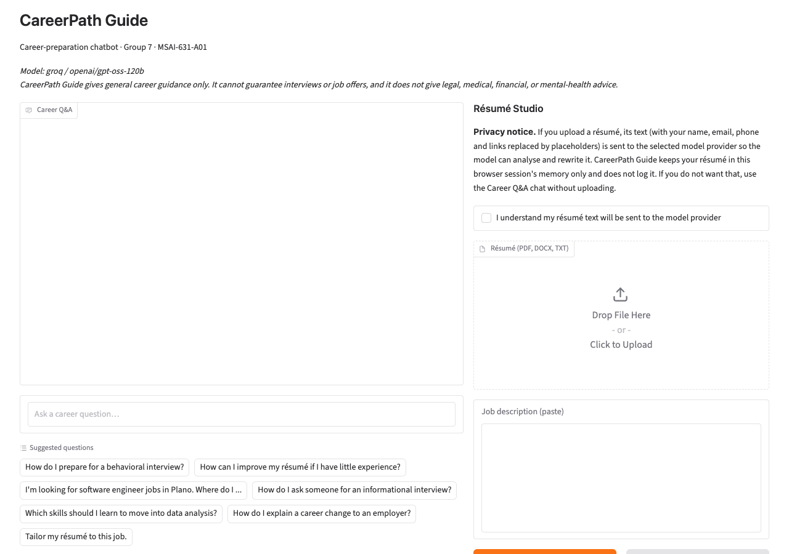
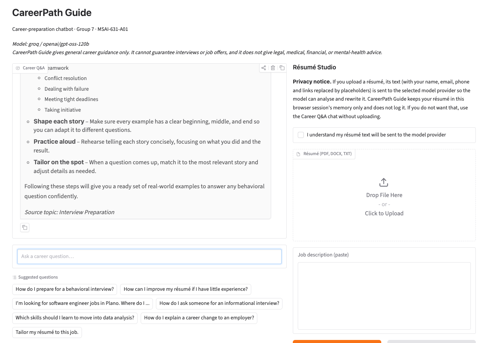
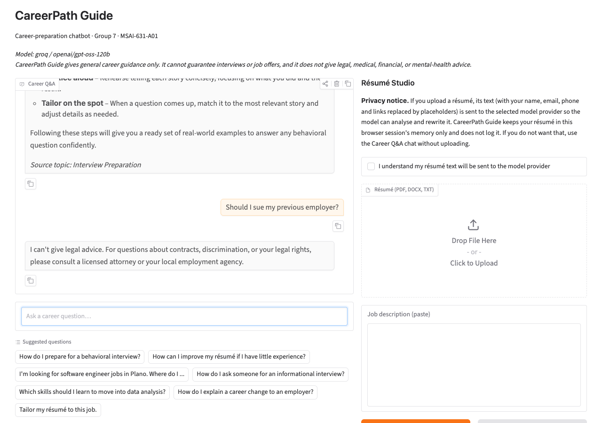
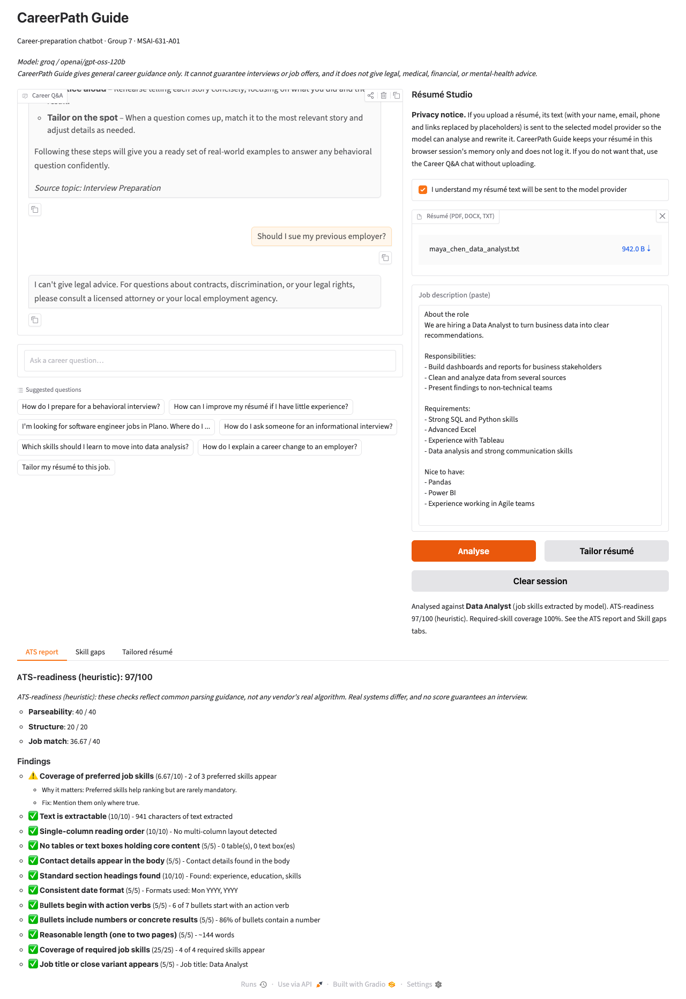
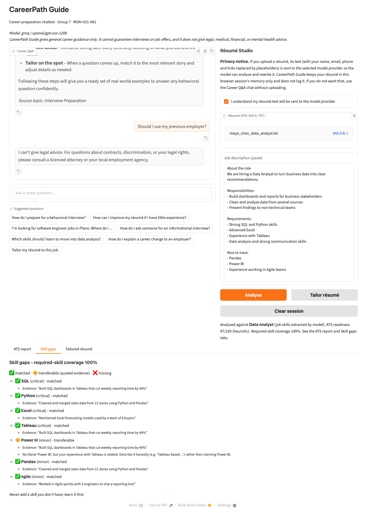
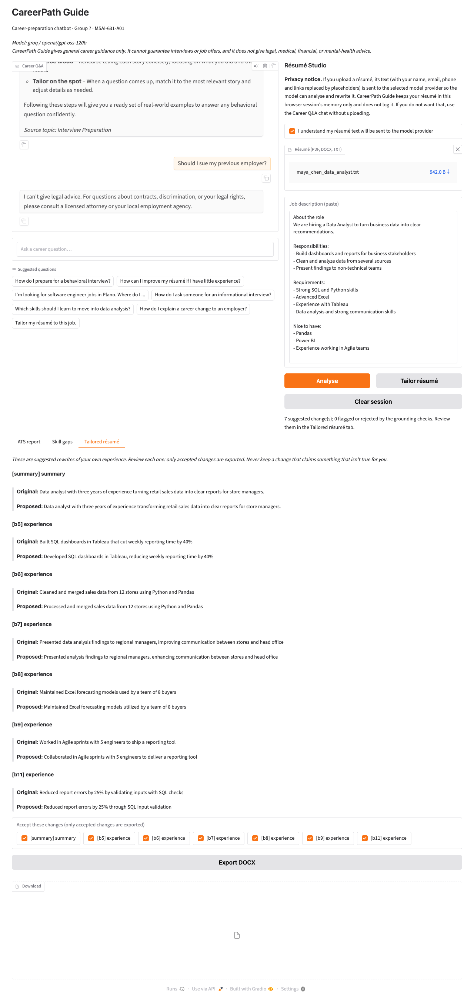

<center>**CareerPath Guide: A Grounded LLM Chatbot for Career Questions and Résumé Tailoring**</center>
<center>Group Project Results Report</center>
<center>Group 7: Charith Reddy Mummadireddy Reddivari, Dathan Neal, Jangmu Sherpa, Sisindri Rachakonda</center>
<center>MSAI-631-A01, Artificial Intelligence for Human-Computer Interaction, University of the Cumberlands</center>
<center>October 2026</center>

<<PAGEBREAK>>

# Summary

CareerPath Guide is a browser-based chatbot for students and early-career job seekers. It has two modes. **Mode A (Career Q&A)** answers questions on six career topics from a small curated knowledge base, labels every answer with its source topic, and politely declines anything outside its scope. **Mode B (Résumé Studio)**, which extends our approved proposal, lets a user upload a résumé for one session, paste a job description, and receive an ATS-readiness report, a skill-gap report, and an optional tailored résumé that the user accepts or rejects change by change.

The application is written in Python with Gradio. It retrieves knowledge with TF-IDF, calls a language model through a replaceable provider adapter, and runs without any key in an offline mode. All source code, test fixtures and evaluation scripts are in the project repository; an evaluator can set one API key in a `.env` file and run `python app.py`.

The main empirical results, all produced by the scripts in `evals/` on synthetic data, are:

- The deterministic parts behave as designed: the scope guard refused 14 of 14 excluded requests with no false refusals on 12 benign prompts, the ATS rules matched all 11 fixtures, and the skill-gap classifier agreed with 98.5% of 130 hand-made labels.
- TF-IDF retrieval picked the right topic for 82.9% of 35 questions, and no single similarity threshold separated in-scope from out-of-scope questions cleanly.
- Deterministic grounding checks caught 85% of 40 hand-written fabrications with no false alarms, but missed all three cases of *semantic inflation* (a stronger verb or a claim of impact that adds no new skill).
- Two Groq-hosted models behaved very differently on the same tailoring task: `openai/gpt-oss-120b` rewrote almost every bullet (102 changes) and 98% passed our checks, while `qwen/qwen3.8-27b` proposed only 8 changes and half of them failed or were flagged.

# 1. Problem and Motivation

Career advice is plentiful but scattered, and generic advice does not tell a specific applicant what to change for a specific job. Students and early-career professionals often send one résumé to many roles. They also cannot easily tell whether the résumé will be read cleanly by an applicant tracking system (ATS) or which required skills it fails to show. General-purpose chatbots can answer such questions, but they have well-known weaknesses for this use: they may sound confident about advice they should not give (legal, medical, financial), and when asked to improve a résumé they may invent experience. Two 2026 preprints measure the second problem directly. In one controlled experiment, a fully automated résumé pipeline produced at least one unsupported claim in 96.7% of outputs, and prompt instructions alone halved but did not remove the problem; a human checkpoint after the rewriting stage was what eliminated invented identities (Takano, 2026). A second study argues that deterministic checks should back up prompt rules because prompts alone are insufficient on weaker models or at higher temperatures (Indukuri & Agrawal, 2026).

Our goal was therefore a *focused, honest and inspectable* assistant: one that stays within a narrow scope, shows where its answers come from, never claims more than it can support, and keeps the user in control of any change to their own résumé.

# 2. Scope

## 2.1 What the approved proposal committed to

The proposal (Group 7, 2026) described a Python and Gradio chatbot with TF-IDF retrieval over a curated Markdown knowledge base, a language model reached through a provider adapter, source-topic labels on answers, a clear fallback for out-of-scope requests, and a modest evaluation. It excluded legal, medical, financial and mental-health advice, employment guarantees, storing personal résumés, scraping job listings, and submitting applications.

## 2.2 What we built, and what changed

| Topic | Proposal | Implementation | Status |
|---|---|---|---|
| Interface | Gradio chat | Gradio chat, file upload and review panel | Extended |
| Career Q&A | TF-IDF + LLM answer with source label | Same (Mode A) | Same |
| Résumé handling | "Will not store personal résumés" | Processed in memory for the current browser session only | Extended; needs instructor confirmation |
| Job source | "Will not scrape job listings" | User pastes the description; no scraping | Boundary kept |
| Applications | "Will not submit applications" | Produces a downloadable résumé only | Same |
| LLM provider | Groq behind an adapter | Groq, OpenRouter, Gemini (OpenAI-compatible) and Anthropic adapters; provider and model are configuration | Extended |
| Out-of-scope advice | Excluded | Excluded by a rule-based guard before any model call | Same |

The résumé feature and the extra providers change the wording of the proposal. Our design document flagged both as needing instructor confirmation before being presented as final scope; the Mode A baseline is complete on its own so the project does not depend on that decision.

## 2.3 Explicitly out of scope

Storing résumés or user profiles, searching or scraping job boards, auto-applying, vector databases, accounts and logins, multi-turn memory, and hosted deployment.

# 3. Approach

## 3.1 Architecture

```
Browser (Gradio)
   |
   v
Engine ──> Router ──> Scope guard ──blocked──> fixed refusal text (no model call)
   |           |
   |           +── qa ──> TF-IDF retriever ──> LLM adapter ──> answer + source topic
   |                          |  (below threshold: fallback text)
   |
   +── résumé + job description
          Ingestion (PDF / DOCX / TXT) ──> redact contact details
          ├─ ATS-readiness rules (deterministic, 100-point score)
          ├─ Job-description analysis (LLM JSON, keyword fallback)
          ├─ Skill-gap classifier (matched / transferable / missing)
          └─ Tailoring (LLM) ──> grounding checks ──> user accepts / rejects ──> DOCX export
```

The code lives in the `careerpath/` package. Every prompt is in one file (`prompts.py`), every user-facing sentence in another (`messages.py`), and knowledge-base content is plain Markdown, so non-programmers on the team can edit wording and content safely.

## 3.2 Mode A: Career Q&A

The knowledge base has one Markdown file per proposal topic (résumé improvement, interview preparation, job search planning, networking, skill development, career transitions) plus an ATS formatting guide. Files are split into passages at second-level headings. The retriever builds a TF-IDF matrix with scikit-learn, strips accents so that "résumé" and "resume" match, applies light stemming, and uses unigrams and bigrams. A question's best passage is passed to the model with an instruction to answer only from that passage in under 200 words; the answer is labelled with the passage's source topic. If the best cosine score is below a threshold (0.12), the user receives a fallback explaining what the assistant can help with, together with suggested questions. A rule-based router and scope guard run first, so requests for legal, medical, financial or mental-health advice, guaranteed outcomes, scraping or auto-applying are refused without calling the model; the mental-health refusal includes the 988 crisis line.

## 3.3 Mode B: Résumé Studio

1. **Ingestion.** PDF (pypdf and pdfplumber), DOCX (python-docx) and TXT files are read in memory. The loader detects multi-column layouts, tables, text boxes and image-only PDFs. Name, email, phone and links are replaced with placeholders before anything is sent to a model and re-attached locally on export.
2. **ATS-readiness check.** A transparent 100-point heuristic: parseability (40), structure (20) and job match (40). Each failed rule shows the evidence, the reason and a fix. We deliberately call it *readiness* rather than a score from any vendor, because industry guides describe most ATS products as parsing résumés into searchable databases rather than assigning a hidden pass or fail (MirrorCV, n.d.; 22skills, n.d.).
3. **Job-description analysis.** The model returns required skills, preferred skills, responsibilities and title as JSON that is validated against a schema; if it fails twice or no key is set, a keyword extractor over the skills taxonomy is used instead.
4. **Skill-gap analysis.** Each job skill is *matched* (the résumé shows it), *transferable* (the résumé shows adjacent evidence, which is quoted verbatim and verified against the résumé text), or *missing* (with a learning suggestion). This follows the transferable-versus-genuine distinction in an open-source job-application assistant (Hariprasad, n.d.).
5. **Grounded tailoring.** The model may reword bullets and the summary, and reorder skills, but receives strict rules: no new skills, numbers, employers, titles, dates or schools. Defence in depth then follows, because prompts alone are not trusted: a deterministic checker compares each proposed change with the original and marks it *ok*, *flagged* or *rejected* (new skill, changed or new number, unverified capitalised entity, or large semantic divergence), and the user must accept each change before export. Rejected changes cannot be exported. The checker also computes the two measures proposed for ResumeFlow: content preservation and job alignment (Zinjad et al., 2024).
6. **Export.** Accepted changes are written to a single-column DOCX with standard headings, the layout the ATS rules favour.

## 3.4 Provider adapter

All model calls go through one `LLMProvider` interface with typed errors (rate limit, authentication, timeout, model unavailable, invalid response). Groq, OpenRouter and Google Gemini share one OpenAI-compatible adapter; Anthropic uses the Messages API with its different `system` field and required `max_tokens` (Anthropic, n.d.-a). With no key configured, the application starts in offline mode, which still gives retrieval-only answers, the ATS check and the skill-gap analysis because those are rule-based. A fake provider backs the automated tests so that all 54 `pytest` tests run without network access.

## 3.5 Technology

Python 3.10+, Gradio, scikit-learn (TF-IDF), pypdf, pdfplumber, python-docx, the `openai` and `anthropic` client libraries, and `pytest`. Total application code is about 2,000 lines.

# 4. Human-Computer Interaction Design

The interface was designed around standard HCI principles, each tied to a concrete feature.

| Principle | Where it appears |
|---|---|
| Visibility of system status | A banner states which provider and model are active, or that the app is in offline mode; every answer is labelled with its source topic. |
| Transparency and explainability | Every ATS deduction lists the evidence, why it matters, and how to fix it; each transferable skill shows the résumé quotation it rests on; the ATS score is labelled a heuristic. |
| User control and freedom | The user accepts or rejects each tailored change and sees it beside the original; one button clears the session. |
| Error prevention | File-type and image-only checks with specific messages; rejected changes cannot be exported; the guard blocks unsafe requests before the model sees them. |
| Recognition over recall | Suggested questions at start and in every fallback; a one-line list of supported topics. |
| Privacy and trust | A plain-language privacy notice and an acknowledgment box before the first upload; contact details never leave the machine; no logging of résumé text. |
| Honest limits | Visible notes that the tool offers no guarantee of interviews or offers and that the user must verify all résumé text. |
| Clarity | Single-column layout, plain language, and short Markdown sections for each report. |

One privacy trade-off should be stated plainly. The exported DOCX has to exist as a temporary file so that the browser can download it; it is created only when the user presses Export. Résumé text is otherwise held only in the session's memory.

## 4.1 The running application

The figures below were captured from the working application (`python app.py`) running against `openai/gpt-oss-120b` on Groq, using the synthetic résumé `maya_chen_data_analyst.txt` and the synthetic data-analyst job description from `tests/fixtures/`. Figure 1 shows the start screen with the active-model banner, the privacy notice and the suggested questions.





Figure 3 shows the scope guard refusing a legal question with a fixed message; no model call is made.



Figure 4 shows the ATS-readiness report. Every rule lists its score and evidence, and the report is labelled a heuristic.





Figure 6 shows the review step: each proposed change appears beside the original, and only accepted changes can be exported.



# 5. Team Responsibilities

Work was divided along the ownership defined in the proposal and extended in the design document. Each source file names its owner, and `docs/TEAM_GUIDE.md` lists what each member should be able to explain.

| Member | Responsibility | Main contributions |
|---|---|---|
| Charith Reddy Mummadireddy Reddivari | Technical architecture and integration | Package structure and configuration; provider adapters; TF-IDF retriever; router and engine; résumé ingestion and redaction; ATS rule engine; gap pipeline; tailoring pipeline and DOCX export; unit tests |
| Dathan Neal | Prompt design and model evaluation | All prompts (Q&A, job description, gaps, tailoring) and JSON handling; grounding-check design with Charith; evaluation harness, live runs and model comparison; fabrication measurements |
| Jangmu Sherpa | Knowledge base and data | Six topic files and the ATS guide; skills taxonomy with aliases, relations and learning suggestions; guard category patterns; synthetic résumés, job descriptions and layout fixtures; hand-made labels for gaps, ATS rules and guard prompts |
| Sisindri Rachakonda | Interface, usability and documentation | Gradio layout and review panel; all user-facing wording, fallback and refusal text; privacy notice; README; this report; usability test plan |

# 6. Evaluation

## 6.1 Method

We evaluated at two levels. **Offline suites** are deterministic and need no key; they test the retriever, guard, ATS rules, gap classifier and grounding checks against hand-written labels. **Live suites** call a real model and measure answer behaviour, JSON validity, fabrication and latency. All inputs are synthetic: five fictional résumés (a data analyst, a software developer, a new graduate, a career changer and a DevOps engineer), three job descriptions (data analyst, software engineer, and a cloud-engineer posting built as a trap because it requires skills that several résumés lack), 35 in-scope plus 8 out-of-scope questions, 14 prompts that must be refused and 12 benign ones that must not, and 11 layout fixtures built to trigger one ATS rule each. Everything can be reproduced with `python -m evals.run_evals` and, with a key, `--live <provider>`.

## 6.2 Offline results

<!-- BEGIN:offline_table -->
| Offline suite | Result |
|---|---|
| Retrieval top-1 topic accuracy (35 in-scope questions) | 82.9% |
| Out-of-scope questions sent to fallback (8) | 62.5% |
| Scope guard: excluded requests refused (14 prompts) | 100.0% |
| Scope guard: false refusals on benign prompts (12 prompts) | 0.0% |
| ATS rules: precision / recall (11 fixtures) | 100.0% / 100.0% |
| Skill-gap agreement with hand labels (130 skills, 15 pairs) | 98.5% |
| Transferable claims with verbatim quotation | 100.0% |
| Fabrications caught by grounding checks (20 cases) | 85.0% |
| Faithful rewrites wrongly flagged (20 cases) | 0.0% |
<!-- END:offline_table -->

**Retrieval.** Top-1 topic accuracy was 82.9%. Networking, interview preparation and career transitions were retrieved perfectly (5/5); résumé improvement and job search planning were weakest (3/5). The wrong-topic cases are informative: "How should I plan my job search?" and "Where can I find job openings?" were pulled toward résumé improvement, and "Will an applicant tracking system reject my resume?" was pulled toward job search planning, because bag-of-words similarity follows shared vocabulary rather than intent. The threshold trade-off is the key design finding:

| Threshold | In-scope answered | In-scope correct topic | Out-of-scope sent to fallback |
|---|---|---|---|
| 0.08 | 100.0% | 82.9% | 62.5% |
| 0.10 | 100.0% | 82.9% | 62.5% |
| **0.12 (chosen)** | **94.3%** | **80.0%** | **62.5%** |
| 0.14 | 88.6% | 77.1% | 62.5% |
| 0.16 | 82.9% | 74.3% | 75.0% |
| 0.20 | 62.9% | 54.3% | 100.0% |
| 0.25 | 45.7% | 42.9% | 100.0% |

Raising the threshold enough to reject every out-of-scope question (0.20) would also reject 37% of legitimate questions, so we kept 0.12 and accept that three of eight off-topic questions get a (cautious) answer from the nearest passage. This is the honest cost of a vocabulary-based retriever with a small knowledge base; the model prompt, which tells the model to use only the passage, limits the damage.

**Scope guard.** All 14 excluded requests were refused with the correct category, and none of 12 benign career prompts were refused. These are patterns written by the same group that wrote the test prompts, so this shows the rules do what we meant, not that they would withstand adversarial phrasing.

**ATS rules.** On 11 fixtures the checker found all 8 intended failures and raised no false alarms (precision and recall 100%); the image-only PDF was rejected with a clear message. Because each fixture was built to trigger one rule, this verifies rule correctness rather than real-world coverage.

**Skill gaps.** The deterministic classifier agreed with 98.5% of 130 labels (all matched labels correct, all transferable labels correct, 75 of 77 missing labels correct). The two disagreements were Data Analysis for the new graduate (predicted transferable from coursework) and Terraform for the DevOps résumé (predicted transferable from a related infrastructure tool). Early in development agreement was lower, because loosely related skills in our taxonomy (for example for Pandas, CI/CD, Terraform and Excel) produced false "transferable" claims; the fix was to tighten the taxonomy, which shows the classifier is only as good as its curated relations.

**Grounding checks.** Against 20 fabricated and 20 faithful hand-written rewrites, the checks caught 85% of fabrications (new skills 6/6, changed numbers 4/4, new numbers 3/3, invented entities 4/4) and wrongly flagged none of the faithful ones. They missed all 3 *semantic inflation* cases, for example "Led Agile sprints with 5 engineers" where the source only said the person took part. A deterministic string-based check cannot tell that a verb implies more responsibility than the original; this is exactly why the user-review step is mandatory rather than optional.

**Local speed.** Index build 1.7 ms, retrieval 0.23 ms per query, ATS check 0.15 ms, gap analysis 0.54 ms, PDF ingestion 9.5 ms: the non-model parts are effectively instant.

## 6.3 Live model results

Dathan ran the live suite against two models available on our Groq account. The proposal and design document named Llama-class models, but the Llama model we first configured returned "model not found" for our account, so we listed the models actually available and compared `openai/gpt-oss-120b` with `qwen/qwen3.8-27b`. We did not run Anthropic or Gemini live; those adapters are covered by unit tests with mocked responses but have not been exercised against the real services, and we make no claims about their quality.

<!-- BEGIN:live_table -->
| Metric | groq / openai/gpt-oss-120b | groq / qwen/qwen3.8-27b |
|---|---|---|
| **Mode A: Q&A** (35 in-scope questions) |  |  |
| Answered by the model | 94.3% | 94.3% |
| Source-topic label present | 94.3% | 94.3% |
| Answer within 200 words | 100.0% | 100.0% |
| Answer/passage word overlap (mean) | 0.279 | 0.399 |
| **Job-description extraction** |  |  |
| Valid JSON, no keyword fallback needed | 100.0% | 100.0% |
| Precision, data_analyst posting | 1.00 | 0.89 |
| Recall, data_analyst posting | 0.78 | 0.89 |
| Precision, software_engineer posting | 0.89 | 0.89 |
| Recall, software_engineer posting | 0.89 | 0.89 |
| **Skill-gap analysis (model-assisted)** |  |  |
| Transferable claims | 27 | 20 |
| Claims with verbatim résumé quotation | 100.0% | 100.0% |
| **Résumé tailoring** (5 résumés × 3 jobs) |  |  |
| Runs completed | 14/15 | 15/15 |
| Changes proposed | 102 | 8 |
| Changes passing all checks | 98.0% | 50.0% |
| Changes flagged for review | 0.0% | 12.5% |
| Changes rejected by deterministic checks | 2.0% | 37.5% |
| Runs where model added a missing skill | 0 | 0 |
| Content preservation (mean, 0-1) | 0.847 | 0.915 |
| Job alignment before → after | 0.317 → 0.317 | 0.297 → 0.297 |
| **Operations** |  |  |
| Model calls (ok / total) | 66/68 | 69/69 |
| Errors | LLMRateLimitError ×2 | none |
| Median latency | 3.11 s | 2.83 s |
| 90th-percentile latency | 14.32 s | 13.37 s |
| Tokens in / out | 24,331 / 26,344 | 22,084 / 9,661 |
<!-- END:live_table -->

*Rows with an empty cell are section headings.*

**Q&A behaviour.** Both models answered all questions that cleared the threshold (94.3% of in-scope questions; the remaining two fell below the threshold and were routed to the fallback), stayed within 200 words, and carried the source label. Qwen's answers overlapped more with the retrieved passage than gpt-oss's (0.399 against 0.279 mean word overlap), meaning it stayed closer to the source text. We use overlap only as a rough proxy for faithfulness; it does not measure whether an answer is *good*.

**Structured extraction.** Both models returned valid JSON for all three job descriptions without falling back to the keyword extractor. Precision and recall against the labelled skills were 0.89 to 1.0, with small mismatches in wording (for example "CI/CD pipelines" for "CI/CD"). Exact string matching penalises these harmless variants, so the true accuracy is slightly higher than the table suggests. gpt-oss missed "Communication" and "Data Analysis" on the data-analyst posting.

**Gap analysis.** In every case the models' transferable claims came with a quotation that appears verbatim in the résumé (100% for both models; 27 and 20 claims).

**Tailoring.** This is where the models differed most.

- `openai/gpt-oss-120b` rewrote nearly every bullet: 102 changes, of which 98% passed all checks, none were flagged, and two (2%) were rejected. Looking at one rejection, a bullet reworded as "Developed a React dashboard presenting metrics … to three internal teams" was rejected for "adding Communication", which is a false positive: the rewrite replaced "displayed" with "presenting", a word that matches our alias for the communication skill, although the bullet describes the same dashboard. Content preservation averaged 0.847.
- `qwen/qwen3.8-27b` proposed only 8 changes across the 15 résumé-and-job pairs, and returned *no* change at all for 9 of them. Of its 8 changes, 50% passed, 12.5% were flagged and 37.5% (3) were rejected. In a follow-up inspection of one such case, the rejection was correct: it rewrote a summary to include "data analysis" for a graduate whose résumé shows no data-analysis work. So the more cautious model was also the one that tried, occasionally, to claim something the résumé did not support, and the deterministic check caught it.
- Neither model added a skill the résumé lacked and left it exportable (0 runs for both), but that outcome was achieved by the combination of the prompt rules and the checks, not by either alone.
- **Job alignment did not move** (0.317 to 0.317 for gpt-oss, 0.297 to 0.297 for Qwen). Our design forbids adding skills the résumé does not show, and our alignment measure counts literal skill terms, so rewording existing evidence cannot raise it. We read this as a limitation of the metric: the tool improves how existing evidence is worded, it does not manufacture coverage, and that is intended.

**Operations.** Median latency was about 3 seconds per call for both models (90th percentile 13 to 14 seconds). gpt-oss used 24,331 input and 26,344 output tokens over 68 calls; Qwen used 22,084 input and 9,661 output tokens over 69 calls. Two of gpt-oss's calls hit the provider's rate limit even after the adapter's retries with back-off, which made one tailoring run fail; the interface reports this as a friendly error.

**Run-to-run variance.** We executed the full live suite twice per model (two identical runs overlapped by accident and the second overwrote the result files). The conclusions held, but numbers moved: in the first run gpt-oss completed all 15 tailoring runs and Qwen failed one; in the second, gpt-oss failed one (rate limit) and Qwen completed all 15, and Qwen's change count shifted from 9 to 8. With 15 pairs per model and non-deterministic generation, differences of a few percentage points between runs should not be over-interpreted; the large gap between the two models in the number of changes was consistent across both runs.

# 7. Challenges and Learnings

**1. Vocabulary retrieval is brittle but sufficient when it fails safely.** TF-IDF is fast, explainable and needs no vector database, but it cannot reliably separate "off topic" from "poorly worded". Our first unit test for an out-of-scope question failed because a generic question scored 0.122, just above our threshold. We responded by removing generic question words from the vocabulary and by making the model prompt answer only from the passage. The lesson: choose the threshold from a sweep over labelled data, as in Section 6.2, rather than by intuition.

**2. Small text details break matching.** "Résumé" with accents did not match "resume" until we normalised Unicode; short skill names such as Go, R and Excel needed case-sensitive matching to avoid matching ordinary words. Each of these appeared only when we wrote tests for real-looking fixtures.

**3. A curated taxonomy is also a source of error.** The first gap run produced false "transferable" claims because we had linked skills too loosely. Tightening the relations raised agreement to 98.5%. Maintaining that file is real work, and it is the part of the system most dependent on human judgement.

**4. Prompt rules are not enough, and neither are string checks.** The literature motivated defence in depth, and our measurements confirm it. The prompt rules kept both models from adding missing skills, the deterministic checks caught what slipped through (including a true fabrication from Qwen), and they also produced a false positive and missed all semantic-inflation cases. Only the user-review step covers the remaining risk, which we therefore made mandatory in the interface.

**5. Model availability is account-specific.** A model name that is valid in documentation returned "not found" on our account. We now treat the provider and model as configuration, document how to change it, and map the failure to a friendly message rather than a stack trace.

**6. Models differ in behaviour, not just quality.** Qwen produced concise, source-hugging answers but was reluctant to rewrite résumés; gpt-oss rewrote eagerly with a high pass rate under our checks. Choosing a default requires deciding which failure matters more. We chose gpt-oss as the Groq default because users who press "Tailor" expect suggestions, and the review step handles over-eagerness.

**7. Document parsing is the least glamorous and most fragile part.** Multi-column PDFs, tables and headers each needed their own detection and message. Building fixtures to trigger exactly one rule at a time made this tractable.

**8. Privacy is an interface decision as much as a technical one.** Redacting contact details, keeping résumé text in memory and showing a plain notice before upload took modest code but substantial discussion about what "not stored" can honestly mean once a file must be downloaded.

**9. Team process.** Splitting the work by ownership let each of us go deeper (taxonomy, prompts, UI, architecture), but cross-cutting changes, such as altering the taxonomy, changed evaluation numbers owned by someone else. We handled this by requiring `pytest` and the offline evaluation to pass, with changed metrics pasted into each pull request.

# 8. Limitations and Future Work

- **Synthetic, small data.** Five résumés, three job descriptions and hand-written labels (made by the same team that built the rules) test correctness, not real-world performance. Our ATS rules are based on vendor and practitioner guides rather than peer-reviewed studies.
- **No human usability study yet.** The design document planned a short walkthrough with five to eight classmates on synthetic data, measuring task completion, comprehension of the report and trust in the review step. We have not run it, so the HCI claims in Section 4 are design intentions supported by the interface behaviour, not user-tested outcomes.
- **Model coverage.** Only two Groq models were run live. Anthropic and Gemini adapters are implemented but untested against the live services.
- **Semantic inflation is not detected** by deterministic checks; a second "evaluator" model, as proposed by Indukuri and Agrawal (2026), would be the next step.
- **Single-turn, single-passage answers.** Mode A does not remember earlier questions and answers from one passage.
- **No coverage of real ATS vendors.** The ATS-readiness score is a heuristic and is labelled as one.

# 9. Responsible Use and AI Assistance

The tool gives no legal, medical, financial or mental-health advice, makes no guarantee of interviews or offers, and never invents résumé content: every change is checked and requires user approval. Real personal data was not used in testing; all fixtures are fictional. API keys live only in a local `.env` file that is excluded from version control. As the proposal stated, AI coding assistants were used to help draft code, tests and documentation; the team reviewed and takes responsibility for the result.

# 10. Conclusion

CareerPath Guide meets the proposal's core goals: a focused career Q&A assistant with source labels, a clear fallback, and enforced scope boundaries, built behind a replaceable provider adapter. Its résumé extension adds three useful, inspectable functions with the user in control. The evaluation shows that the deterministic components are reliable on their test sets, that vocabulary retrieval needs careful thresholding, that model prompts and string checks each miss different fabrication cases, and that a human review step is therefore a necessity rather than a nicety. The most important next steps are a real usability study and live runs on more providers.

# References

22skills. (n.d.). *How ATS software works: Parsing, matching, and scoring explained*. https://www.22skills.com/blog/how-ats-software-works

Anthropic. (n.d.-a). *Messages*. https://docs.anthropic.com/en/api/messages

Group 7. (2026). *Group project proposal: CareerPath Guide* [Unpublished manuscript]. University of the Cumberlands.

Hariprasad, S. (n.d.). *jobbot* [Computer software]. GitHub. https://github.com/shruthi-hariprasad/jobbot

Indukuri, S., & Agrawal, A. (2026). *Grounded optimization: A layered engineering framework for reducing LLM hallucination in automated personal document rewriting* (arXiv:2607.01457). arXiv. https://arxiv.org/abs/2607.01457

MirrorCV. (n.d.). *ATS résumé guide 2026: Format, keywords & what actually gets filtered*. https://mirrorcv.com/resume-guide/ats-resume-optimization

Takano, H. (2026). *Mitigating fabrication in multi-stage LLM pipelines for hiring: An empirical evaluation of prompt guardrails and human-in-the-loop checkpoints* (arXiv:2608.26171). arXiv. https://arxiv.org/abs/2608.26171

Zinjad, S. B., Bhattacharjee, A., Bhilegaonkar, A., & Liu, H. (2024). ResumeFlow: An LLM-facilitated pipeline for personalized resume generation and refinement. In *Proceedings of the 47th International ACM SIGIR Conference on Research and Development in Information Retrieval*. ACM. https://doi.org/10.1145/3626772.3657680

# Appendix A: How to Reproduce

```
pip install -r requirements.txt -r requirements-dev.txt
pytest                                         # 54 tests, offline
python -m evals.run_evals                      # offline suites
python -m evals.run_evals --live groq --model openai/gpt-oss-120b
python -m evals.run_evals --live groq --model qwen/qwen3.8-27b
python scripts/build_report.py                 # refresh the tables above and the .docx
```

Raw results: `evals/results/offline_results.{json,md}` and `evals/results/live_*.{json,md}`.
